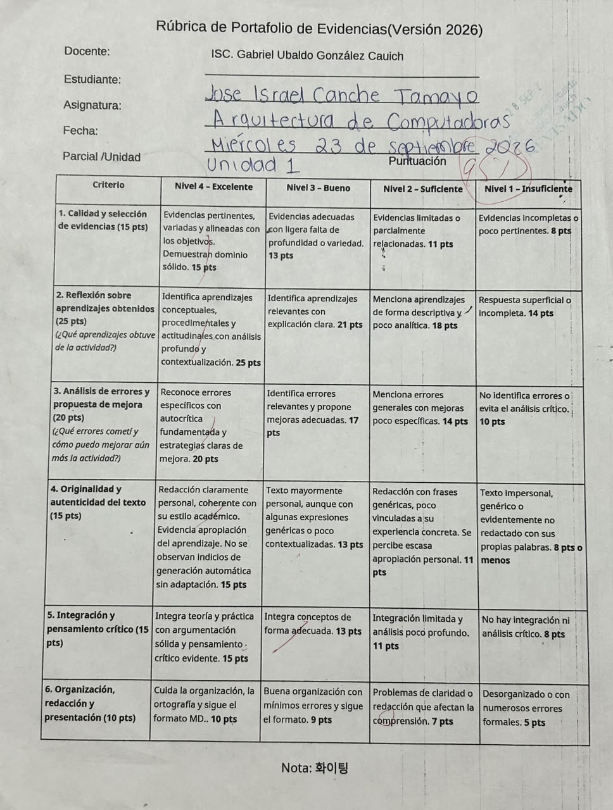
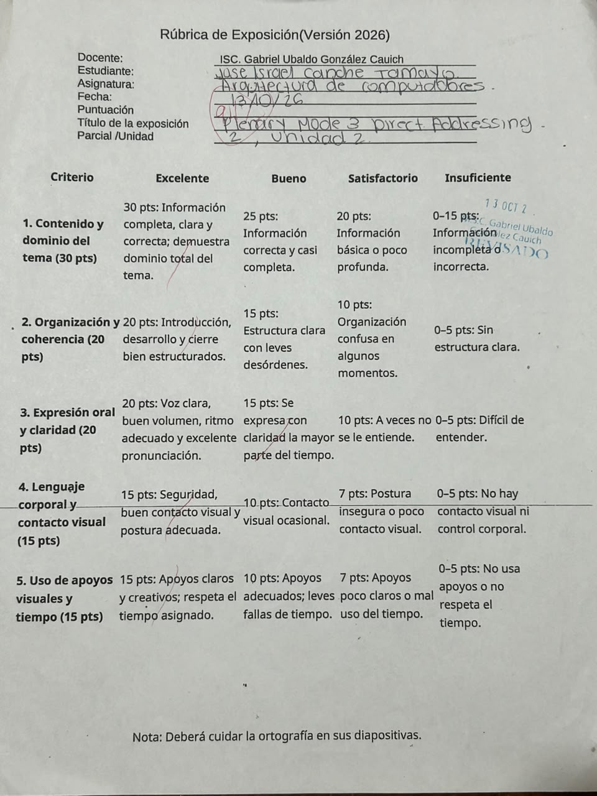

# Portafolio de Evidencias - Unidad 2

## Arquitectura de Computadoras
**Alumno:** Jose Israel Canche Tamayo 

**Semestre y grupo:** 5B  
**Materia:** Arquitectura de Computadoras  
**Docente:** Gabriel Ubaldo González Cauich  
**Unidad:** 2  
**Actividad:** Portafolio de Evidencias  
**Período:** 2026-B 

**Motul, Yucatán, México; 21 de octubre de 2026**

---

# Introducción
El presente portafolio de evidencias corresponde a la Unidad 2 y reúne los trabajos, actividades y productos realizados durante este periodo de aprendizaje.

Su propósito es demostrar de manera clara y organizada el progreso alcanzado en los contenidos y competencias de la unidad, cada evidencia incluida refleja el esfuerzo, la reflexión y la aplicación práctica de los conocimientos adquiridos. A través de este documento se busca evidenciar no solo los resultados finales, sino también el proceso de construcción del aprendizaje, las actividades seleccionadas muestran el desarrollo de habilidades cognitivas, procedimentales y actitudinales, este portafolio permite visualizar de forma integral los avances logrados a lo largo de la unidad.

Asimismo, favorece la autoevaluación y la toma de conciencia sobre las fortalezas y áreas de mejora y la organización de las evidencias sigue una secuencia lógica que facilita su revisión y análisis.

---

# Objetivo del Portafolio 
El presente portafolio de evidencias tiene como objetivo demostrar de manera organizada y reflexiva los aprendizajes, habilidades y competencias adquiridas durante el desarrollo de la Unidad 2, a través de la recopilación, análisis y presentación de productos, actividades y evidencias que evidencien el proceso de construcción del conocimiento, el cumplimiento de los propósitos formativos y el progreso personal.

---

# Índice

1. [Rúbrica del Portafolio](#1-portafolio-de-evidencias-unidad1)
2. [Rúbrica Plenaria](#2-plenary-mode3-direct-addressing)
3. [Ejercicios de Clase Microproccessor](#3-ejercicios-realizados-en-clase)
4. [Questions and Problems Chapter 2](#4-)
5. [Ejercicios del Modo de Direccionamiento.](#5-ejercicios--realizados-en-clase)
6. [Questions and Problems Chapter 3](#6-)
7. [Reflexión General de la Unidad 2](#reflexión-general-de-la-unidad2)
8. [Conclusión](#conclusión) 

---

# 1. Rúbrica del Portafolio de la Unidad 1 

## Descripción de la actividad
En esta actividad se realizó la primera evaluación del portafolio de evidencias correspondiente a la Unidad 1 de la asignatura Arquitectura de Computadoras, con el propósito de evaluar la calidad de las evidencias, los aprendizajes obtenidos, el análisis de errores, la originalidad del texto y la organización del portafolio.

## Evidencia 

## ¿Qué aprendí?

Aprendí que un portafolio de evidencias no consiste únicamente en reunir las actividades realizadas, sino también en explicar lo aprendido y reflexionar sobre los resultados obtenidos. Comprendí la importancia de seleccionar evidencias relacionadas con los temas de la unidad, redactar reflexiones con mis propias palabras y reconocer los errores que puedo corregir. 

## Errores y aspectos por mejorar

Uno de los aspectos que debo mejorar es profundizar en mis reflexiones, explicando con mayor claridad qué conocimientos adquirí y cómo puedo aplicarlos. También necesito identificar errores específicos en mis actividades y proponer soluciones concretas, en lugar de mencionar únicamente aspectos generales. 

---

# 2. Rúbrica de Exposición Mode 3 Direct Addressing 

## Descripción de la actividad

En esta actividad se realizó una plenaria sobre el tema “Direct Addressing on Mode 3”, correspondiente a la Unidad 2 de la asignatura Arquitectura de Computadoras. Durante la exposición se abordó el funcionamiento del direccionamiento directo en el Modo 3, con el propósito de comprender cómo se utiliza para acceder a los datos en una instrucción. La actividad fue evaluada mediante una rúbrica que consideró el dominio del tema, la organización de la información, la expresión oral, el lenguaje corporal y el uso de apoyos visuales.

## Evidencia 

## ¿Qué aprendí?

Aprendí la importancia de comprender el funcionamiento del direccionamiento directo y su relación con las instrucciones del procesador. Además, mediante la plenaria, pude reforzar mis conocimientos sobre el tema y reconocer la importancia de explicar la información de manera ordenada y comprensible. También comprendí que, al presentar un tema frente al grupo, no basta con conocer la información, sino que es necesario comunicarla con claridad, mantener el contacto visual y utilizar apoyos visuales que faciliten la comprensión.

## Errores y aspectos por mejorar

Debo continuar mejorando mi seguridad al hablar frente al grupo y procurar que la explicación de los conceptos técnicos sea clara y precisa. También es importante organizar la información de la presentación con una introducción, un desarrollo y un cierre bien definidos. Como aspecto adicional, debo revisar la ortografía de las diapositivas, practicar la pronunciación de los términos técnicos y administrar mejor el tiempo para explicar los puntos más importantes sin apresurar la exposición.

